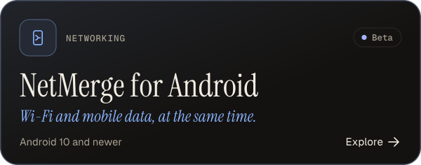
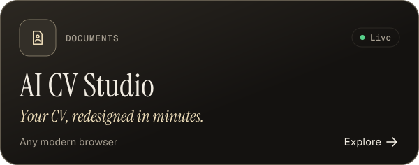
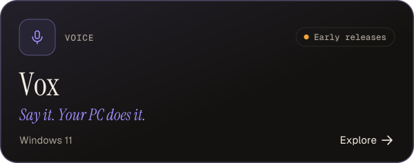
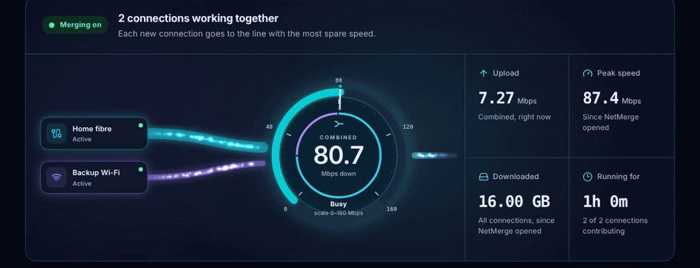
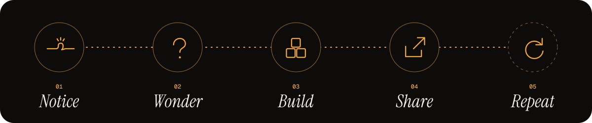

### Hi, I'm Nisar. Thanks for stopping by.

Most of what I build starts with a small annoyance: something that's missing, a step that's slower than it should be, a job I keep doing by hand. Sometimes I need the fix myself. Sometimes the idea is just too interesting to leave alone.

When it turns out useful, I put it on **[nisarworks.com](https://nisarworks.com/)**, the home for everything I make.

 

### Things I've built

  
  
  
  
  
  

Each one has its own page with screenshots, what it does and what it can't do yet. **[See them all at nisarworks.com/products](https://nisarworks.com/products/)**

 

### See one working

NetMerge's Overview, recorded from the real window with made-up connection data. <a href="https://nisarworks.com/products/netmerge/">Watch the 78-second tour on its page.</a>

 

### How it usually goes

**Notice.** Something small gets in the way. Then it does it again. 
**Wonder.** Is there a simple tool for this? If not, could I make one? 
**Build.** My favourite part. Lots of trying, breaking things and learning. 
**Share.** If it helped me, it might help you. So it goes up here. 
**Repeat.** "It works" is rarely the end. There is usually a better way.

 

 

### Come say hi

Use anything you find here. If something breaks or could work better, open an issue on its repository. And if a small problem has been bugging you lately, tell me about it. Chances are I'll find it interesting too.

  <a href="https://nisarworks.com/"><b>nisarworks.com</b></a> &nbsp;·&nbsp; <a href="https://nisarworks.com/products/">Products</a> &nbsp;·&nbsp; <a href="https://nisarworks.com/about/">About</a>

Built for the fun of it. Shared in case it helps.

