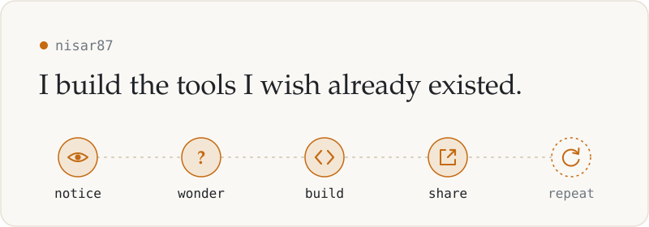
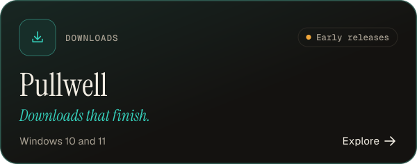
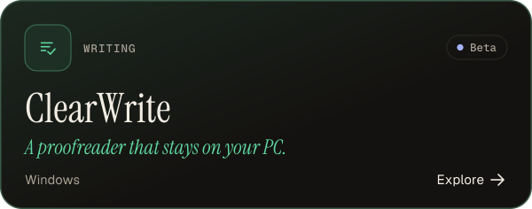

<picture>
  <source media="(prefers-color-scheme: dark)" srcset="assets/header-dark.svg">
  <source media="(prefers-color-scheme: light)" srcset="assets/header-light.svg">
  
</picture>

### Hi, thanks for stopping by.

Most of what I build starts with a small annoyance: something that's missing, a step that's slower than it should be, a job I keep doing by hand. Sometimes I need the fix myself. Sometimes the idea is just too interesting to leave alone.

And when it turns out useful, I put it here, free for anyone.

 

### How it usually goes

**Notice.** Something small gets in the way. Then it does it again. 
**Wonder.** Is there a simple tool for this? If not, why not? Could I make one? 
**Build.** My favorite part. Lots of trying, breaking things, and learning something new. 
**Share.** If it helped me, it might help you too. So it goes up here. 
**Repeat.** "It works" is rarely the end. There's usually a better way, and I like finding it.

 

### Things I've built

<table>
  <tr>
    <td width="64" align="center"></td>
    <td>
      <a href="https://github.com/nisar87/netmerge"><b>NetMerge</b></a> 
      Two internet connections at home, but only one doing any work? NetMerge puts them all to use at once on Windows 11, with per-app control, usage tracking, and sharing with your phone. No extra hardware, no paid service. 
      Windows 11 · MIT · actively updated
    </td>
  </tr>
  <tr>
    <td width="64" align="center"></td>
    <td>
      <a href="https://github.com/nisar87/pullwell"><b>Pullwell</b></a> 
      A download manager for Windows that doesn't give up halfway. It resumes after crashes and dropped connections, checks that every finished file is actually complete, and sends no telemetry. 
      Windows 10 &amp; 11 · MIT · early releases, in daily use
    </td>
  </tr>
  <tr>
    <td width="64" align="center"></td>
    <td>
      <a href="https://github.com/nisar87/ClearWrite"><b>ClearWrite</b></a> 
      A writing assistant for Windows that checks your spelling and grammar right on your own computer, with no account or internet connection needed. AI help is there if you want it, and only if you turn it on. 
      Windows · MIT · beta
    </td>
  </tr>
</table>

 

### Why I share them

I don't think software always has to be a business. Sometimes a problem is interesting, a solution seems possible, and building it is reward enough. If it helps someone else along the way, even better.

So everything here is free and open source. I try to keep it honest, too: each project says plainly what it can and can't do yet, and I keep improving them long after they first work.

> *Not every project needs a business plan. Some just need a good question and a free evening.*

 

### Come say hi

Use anything you find here. If something breaks or could work better, open an issue; pull requests are even more welcome. And if a small problem has been bugging you lately, tell me about it. Chances are I'll find it interesting too.

 

Built for the fun of it. Shared in case it helps.

